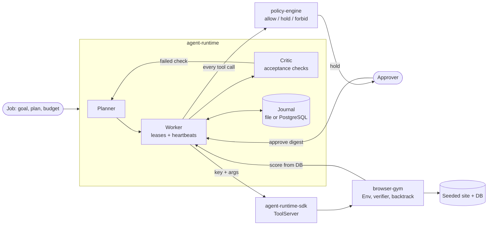

# hana-agents

A durable runtime for long agent jobs, with permission rules at the tool boundary and a browser environment to test
agents that use the web. Jobs survive crashes without repeating side effects; every tool call is allowed, held for a
person, or forbidden by written policy before it runs; and browser tasks are scored on what the site's database holds
at the end.

| Component | Language | What it does |
| --- | --- | --- |
| [`agent-runtime`](go/agent-runtime) | Go | Journalled planner, workers and critic; resumes after a crash, reusing recorded tool results by idempotency key; approvals and budgets. |
| [`policy-engine`](go/policy-engine) | Go, TypeScript, TLA+ | Cedar policies decide allow, hold or forbid for every tool call; scoped tokens, argument-bound approvals, time windows, audit log. |
| [`browser-gym`](packages/browser-gym) | Python, TypeScript | Browser tasks on seeded sites, a pre-submit verifier, backtracking, and step-by-step scoring on the final database. |
| [`agent-runtime-sdk`](packages/agent-runtime-sdk) | Python | Serves Python tools to the runtime with idempotent results, and drives jobs over HTTP. |

## Architecture

How the pieces connect:

- `runtime.Engine` calls `decide.Engine.Decide` (policy-engine) before each tool call and journals the decision. A
  hold becomes an `approval_needed` event; `agentctl jobs approve` records an approval bound to
  `approval.Digest(principal, action, args)`, so only that exact call proceeds.
- `browser-gym serve` publishes the environment as `browser.*` tools through `agent_runtime.ToolServer`; runtimed
  discovers them and calls them with idempotency keys, so a resumed job never opens a second session or submits twice.
- `go/policy-engine/policies/examples/browser.cedar` holds every irreversible `browser.submit` for a person.
