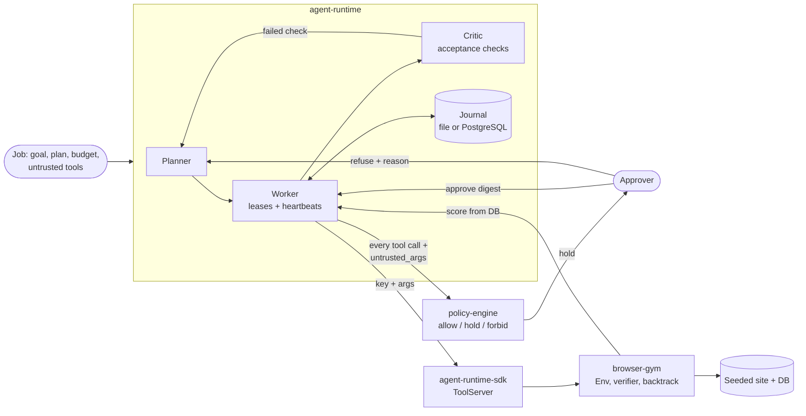

# hana-agents

[](https://github.com/hanaml-lab/hana-agents/actions/workflows/ci.yml)
[](LICENSE)

A durable runtime for long agent jobs, with permission rules at the tool boundary and a browser environment to test
agents that use the web. Every model call, tool call, approval and result is an event in an append-only journal, so a
job survives a crash by replay and never repeats a side effect. Every tool call is allowed, held for a person or
forbidden by written Cedar policy before it runs; approvals are bound to a digest of the exact arguments, and the
policy sees which arguments derive from untrusted content. Browser tasks are scored on what the site's database holds
at the end. This is the system repo of the [durable agents](https://hanaml.com/research/durable-agents) research
project.

| Component | Language | What it does |
| --- | --- | --- |
| [`agent-runtime`](go/agent-runtime) | Go | Journalled planner, workers and critic; resumes after a crash, reusing recorded tool results by idempotency key; approvals and refusals, argument provenance, and budgets in steps, tokens, cost and time; `runtimed` and `agentctl`. |
| [`policy-engine`](go/policy-engine) | Go, TypeScript, TLA+ | Cedar policies decide allow, hold or forbid for every tool call; capability tokens, argument-bound approvals, time windows, a hash-chained audit log, and TLA+ specifications checked with TLC. |
| [`browser-gym`](packages/browser-gym) | Python, TypeScript | Browser tasks on seeded sites, pruned accessibility observations, a pre-submit verifier, backtracking, and step-by-step scoring on the final database; serves itself as runtime tools. |
| [`agent-runtime-sdk`](packages/agent-runtime-sdk) | Python | Serves Python tools to the runtime with results stored by idempotency key, and starts, follows, approves and refuses jobs over HTTP. |
| [`integration`](go/integration) | Go, Python | A browser-gym task run as a runtime job under policy, including a crash after an irreversible submit. |

## Install

Go 1.25 or later, Python 3.10 or later with [uv](https://docs.astral.sh/uv/), Node 22.18 or later for the TypeScript
packages, and Java 11 or later for `make spec`.

```bash
git clone https://github.com/hanaml-lab/hana-agents && cd hana-agents
uv sync              # agent-runtime-sdk and browser-gym into .venv
make build           # runtimed, agentctl and policyd into bin/
```

## Quickstart

```bash
make example         # a browser task as a runtime job: held submit, approval, score
```

`examples/browser-job/run.sh` starts the browser-gym tool server and `runtimed`, starts the job in
`examples/browser-job/plan.json`, tails it to the held submit, approves it with `agentctl jobs approve`, and prints the
final score. Everything runs offline:

```text
  35 approval_needed  submit       {"step_id":"submit","action":"browser.submit","args":{"irreversible":true,...
job 01M4WMW5DCPNNREQQR8550ZC39: done after 46 events
  submit         browser.submit     attempt 0  done
  score          browser.score      attempt 0  done
{"status":"done","steps_done":8,"result":{"success":true,"steps":6,"irreversible_errors":0,"progress":1.0}}
```

The same flow from Go, with a policy that holds a payment whose payee was read from an invoice rather than written in
the plan:

```go
set, _ := decide.Compile(map[string]string{"p.cedar": `
    @id("read") permit (principal, action == Action::"inbox.read", resource);
    @id("pay")  permit (principal, action == Action::"payments.send", resource);
    @hold("untrusted-payee") permit (principal, action == Action::"payments.send", resource)
    when { "payee" in context.untrusted_args };`})
e := runtime.NewEngine(runtime.NewMemJournal(), runtime.StaticPlanner{}, decide.New(set))
id, _ := e.Start(ctx, runtime.Job{
    Principal: "agent:ap-clerk",
    Tools:     []runtime.Tool{inbox, payments},
    Untrusted: []string{"inbox.read"},
    Plan: []runtime.Step{
        {ID: "invoice", Tool: "inbox.read"},
        {ID: "pay", Tool: "payments.send", Args: map[string]any{"payee": "${steps.invoice.payee}", "amount": 100}},
    },
    Budget: runtime.Budget{Steps: 20, CostUSD: 2.50, Seconds: 3600},
})
_, err := e.Run(ctx, id)                                 // runtime.ErrAwaitingApproval, rule "untrusted-payee"
_ = e.Reject(ctx, id, "maria", "payee changed by email") // the step goes back to the planner with the reason
```

`go/agent-runtime/examples/invoice-reconcile` is an in-process example of a back-office job you can interrupt and
resume.

## Architecture



- `runtime.Engine` calls `decide.Engine.Decide` before each tool call and journals the decision with the rule that
  made it. A hold becomes an `approval_needed` event. `agentctl jobs approve` records an approval bound to
  `approval.Digest(principal, action, args)`, so only that exact call proceeds, once; `agentctl jobs reject` records a
  refusal, and the step goes back to the planner with the reason.
- A job names the tools whose output is untrusted (a mailbox, a browser). The runtime follows `${steps.<id>.<path>}`
  references through the journalled plan and passes the names of the arguments that derive from that output as
  `context.untrusted_args`. Taint follows data, so a trusted tool called with an untrusted argument returns an
  untrusted result. A policy can then treat prompt injection as an authority problem, in the spirit of
  [CaMeL](https://arxiv.org/abs/2503.18813).
- Every tool call carries an idempotency key derived from the job, the step and the attempt. The attempt advances only
  when a step is sent back, never on a crash, so a resumed job calls with the key it used before.
- Budgets in steps, tokens, cost (`_usage.cost_usd` in tool results) and time (from the `job_started` event, across
  restarts) are enforced by the runtime, not the prompt. Policy time windows such as `@window("first 1h")` count
  from the same start.
- `browser-gym serve` publishes the environment as `browser.*` tools through `agent_runtime.ToolServer`; `runtimed`
  discovers them and calls them with idempotency keys, so a resumed job never opens a second session or submits twice.
  `go/policy-engine/policies/examples/browser.cedar` holds every irreversible `browser.submit` for a person.
- `go/policy-engine/spec/Decide.tla` models the decision table and `Approvals.tla` the journal's rules for spending
  approvals and calling tools. `make spec` checks both with TLC and confirms that each mutant in
  `spec/mutants.txt` breaks the invariant it names.

## Results

### Reproduced by this repo

Each of these runs offline on a laptop, and CI runs all of them.

| Command | What it checks | Result |
| --- | --- | --- |
| `make example` | A browser form task as a runtime job, with the irreversible submit held and approved | success, 6 environment steps, 0 irreversible errors, progress 1.0 |
| `make crash-suite` | 200 jobs, each killed at a random journal write and resumed by a fresh engine | 200 of 200 complete, with exactly one external effect per effectful step |
| `make spec` | TLC on `Decide.tla` (16 states) and `Approvals.tla` (3,622 states), then 4 mutants of `Approvals.tla` with a seeded bug each | no invariant violated; 4 of 4 mutants caught |

### Reported in the papers

The project's two papers report these numbers; each row quotes its paper. Both papers are seeded simulation studies
calibrated to public figures, as their limitations sections say. BELAY's crash study measures this repo's journal
and idempotency keys; BELAY's placement program and CCV's calibrated verifiers are in the paper repos.

| Metric | Baseline | Result | Setting | Paper |
| --- | --- | --- | --- | --- |
| Task success, τ-bench retail | 52.3% | 63.5% | Qwen3-32B; single agent vs. BELAY at λ₀ = 0.2 and 1.22× tokens; a critic after every step reaches 65.0% at 2.08× | [BELAY](https://hanaml.com/research/papers/cost-of-reliability-long-runs) |
| Task success, 200 back-office jobs | 47.8% | 67.7% | Single agent vs. BELAY at 1.21× tokens; a critic after every step reaches 62.4% at 2.06× | BELAY |
| Prediction error on held-out policies (MAE) | 4.5 pts | 0.8 pts | Independent-step fit vs. BELAY's model; 52 held-out (policy, benchmark) pairs | BELAY |
| Jobs that still succeed after an injected crash | 38% | 97% | Restarting an in-memory loop vs. journal plus idempotency keys; 200 back-office jobs, one crash each | BELAY |
| Duplicate side effects per 100 jobs | 4.9 | 0.0 | Restart from scratch vs. journal plus idempotency keys; the same crashes | BELAY |
| Resolved, SWE-bench Verified, equal tokens | 64.0% | 71.5% | Qwen3-Coder-30B-A3B in OpenHands; hybrid-verifier best-of-8 vs. CCV adaptive, which reaches 68.8% with 40% fewer tokens at the threshold set to match it | [CCV](https://hanaml.com/research/papers/verifier-search-agents) |
| Solved, Terminal-Bench 2.0, near-equal compute | 36.2% | 43.8% | Qwen3-Coder-480B-A35B in Terminus 2; hybrid-verifier best-of-8 (10.91M tokens per task) vs. CCV adaptive (11.57M) | CCV |

### Reported by the components

`go/policy-engine` and `packages/browser-gym` report these in their READMEs; no paper covers them.
`go/policy-engine/bench/agentdojo` replays exported AgentDojo tool calls through the policies; the WebArena and
OSWorld runs need models and harnesses that are not in this repo.

| Metric | Baseline | Result | Note |
| --- | --- | --- | --- |
| Injection attacks leading to a forbidden action, AgentDojo | 24% | 0.8% | Prompt-level defence vs. tool-boundary policy; same agent |
| Benign task success, AgentDojo | 69% | 64% | Cost of stricter policy on legitimate tasks |
| Policy check latency p99 | n/a | 2.1 ms | Cedar evaluation incl. approval-digest lookup |
| Seeded policy bugs caught by model checking | 11 of 20 | 19 of 20 | Unit tests alone vs. unit tests + TLA+ traces |
| WebArena task success | 31.5% | 39.8% | Same VLM; with verifier and backtracking |
| OSWorld success (screenshot + a11y tree) | 18.2% | 23.9% | 369-task suite, 50-step limit |
| Irreversible wrong submissions | 9.1% | 2.4% | Share of tasks ending in a wrong form submit |
| Mean steps per successful task | 14.2 | 17.6 | Recovery adds steps |

## Papers

The project's papers, in order; the later one builds on the earlier.

| Date | Paper | What this repo implements | PDF | Paper repo |
| --- | --- | --- | --- | --- |
| 2025-12-09 | [Where to Check: Budget-Optimal Placement of Verifiers and Rollbacks for Long-Horizon Agents](https://hanaml.com/research/papers/cost-of-reliability-long-runs) | The runtime it measures: the journal, deterministic replay, idempotency keys, the critic and the crash suite. The derailment model and the placement program are in the paper repo. | [PDF](https://hanaml.com/papers/cost-of-reliability-long-runs.pdf) | [cost-of-reliability-long-runs](https://github.com/hanaml-lab/cost-of-reliability-long-runs) |
| 2026-05-14 | [Knowing When to Submit: Calibrated Completion Verifiers for Budgeted Search over Coding and Terminal Agent Trajectories](https://hanaml.com/research/papers/verifier-search-agents) | The setting it starts from: browser-gym's pre-submit verifier, backtracking and held irreversible actions. The calibrated verifiers, the budgeted search and the conformal bound are in the paper repo. | [PDF](https://hanaml.com/papers/verifier-search-agents.pdf) | [verifier-search-agents](https://github.com/hanaml-lab/verifier-search-agents) |

## Models

- [llama-toolcall-guard-1b](https://hanaml.com/models/llama-toolcall-guard-1b): a 1B classifier that reads a request,
  the tool and the arguments an agent wants to use, and says allow, ask or block, in a few tens of milliseconds.

## Development

```bash
make test            # Go unit tests, Python tests, TypeScript tests, and the Go integration test
make crash-suite     # 200 jobs, each killed at a random journal write, checked for exactly-once effects
make spec            # TLC on the TLA+ specifications, then the mutants
make lint            # ruff and gofmt
```

The integration test (`go/integration`) starts the Python tool server itself; set `HANA_PYTHON` to a Python with
browser-gym installed (`make test-integration` uses the uv environment). CI runs lint, every test, the example and the
specifications on each push and pull request, and the PostgreSQL journal tests against a PostgreSQL 16 service.

## Contributing

See [CONTRIBUTING.md](CONTRIBUTING.md). Report security issues privately, as the
[security policy](https://github.com/hanaml-lab/.github/blob/main/SECURITY.md) describes.

## Citation

If you use hana-agents, please cite it; [CITATION.cff](CITATION.cff) holds the same entry.

```bibtex
@software{hanaml_hana_agents_2026,
  author  = {{hanaML}},
  title   = {hana-agents: a durable runtime for long agent jobs with permission rules at the tool boundary},
  year    = {2026},
  version = {0.6.0},
  url     = {https://github.com/hanaml-lab/hana-agents}
}
```

If you rely on the runtime's reliability results, please also cite the paper:

```bibtex
@techreport{agarwal2025reliability,
  author      = {Agarwal, Manav},
  title       = {Where to Check: Budget-Optimal Placement of Verifiers and Rollbacks for Long-Horizon Agents},
  institution = {hanaML},
  type        = {Technical report},
  year        = {2025},
  url         = {https://hanaml.com/research/papers/cost-of-reliability-long-runs}
}
```

## Licence

Apache-2.0. See [LICENSE](LICENSE).
